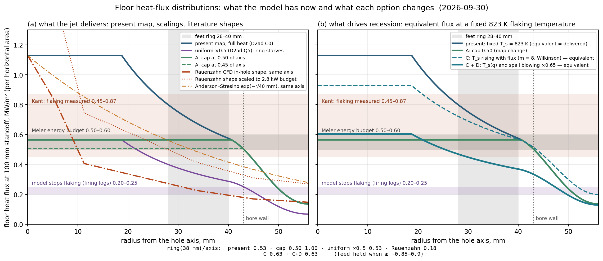

# 2026-09-30 — D2ad follow-up, the Level-and-Shape page, and the Tester-group theses

## 1. Where the day started
D2ad (flux-calibration ladder) left an EMPTY window: cutting the floor flux shrinks the fired
radius (feet ring 28–40 mm stalls) before the axis standoff reaches Fig. 8.8's ≤100 mm. Other
agent's reading agreed on the mechanism; my disagreements (logged in chat, carried here):
* full-heat floor is NOT a cone — inside the bore it is a hemisphere of the bore radius to 1 mm
  (axis lead 3.9/9.8/18.8 mm at r 20/28/36 vs 4.9/10.2/19.0 for R = 43.6); the 40–48 band
  straddles the wall;
* "flatten at constant total power" fails the standoff half by construction under prescribed
  feed (standoff is set by the AXIS flux level; flat at C0 power ⇒ axis ≈0.85–0.9 of C0 ⇒ ~170 mm);
* R90: both 3.3 (settled, s* formula) and 4.24 (early axis) are real; the brief (mine) did not
  define it operationally — not the implementer's error; 198·F held to 4 % on 5 legs;
* resting mode: lower bound of the window is 50 mm and criterion (ii) already permits resting
  (gap ≈ 0); Q35 with 289 mm of rock above the foot plane is not resting; a force balance would
  have stalled it to the ring's 0.62 m/h.

## 2. Firing logs by radius (new measurement, from `*_removal_events.csv`, quarter domain, 2 mm)
Recession mm/100 s (feed 41.7):

| band | C0 400–600 | Q5 700–800 | Q5T870 700–800 | Q35 700–800 |
|---|---|---|---|---|
| 0–36 | 48–50 | 43 | 43–44 | 19–42 |
| 36–40 | 48 | 32 | 9 | 0 |
| 40–44 | 50 | 0 | 0 | 0 |

⇒ model stops flaking below ≈0.2–0.25 MW/m², needs ≈0.45 to hold the feed; ring needs ≥0.85–0.9
of the axis flux at the level that holds the feed. `pad_shield_open` is unset (−1) — not the
cause. Side faces inside r < side_face_h_r_min (40 mm) DO inherit the impinging map h (kernel
:2926, ledger :3515), so the shoulder is side-heated; but removal is per-column top-face only
(`spall.surface_normal=0` in every Meier run — the Step-20 slope-aware kernel is OFF).

## 3. Current floor map, evaluated (h_expr from FH.log)
Martin SRN local form, flat inside r = 18.75 mm, normalised to 1449 W/m²K at s = 50 mm, radial
form evaluated at s clamped to [15, 90] mm, ×(0.09/s) beyond 90 mm, raised-cosine blend to 142
W/m²K over r = 40–56 mm, to 0.001 over 60–76 mm; above the plane 142·w2.
At s = 100 mm: fraction of axis 1.00 (≤16) / 0.71 (28) / 0.51 (40) / 0.27 (48) / 0.12 (56).
Power at s = 100, ΔT 957 K: 0.9 / 1.6 / 1.7 / 1.0 / 0.5 / 0.6 kW in 0–16 / 16–28 / 28–40 /
40–48 / 48–56 / 56–76 ⇒ 4.2 kW inside 40 mm (Meier budget ≈ 2.8). Cap at 0.45/0.50 of axis ⇒
2.55/2.84 kW inside 40 mm, 0.51/0.56 MW/m²; Meier's 0.55 MW/m² ⇔ 0.49 of axis.

## 4. HTML written
`htmls/2026-09-30_level_and_shape.html` → https://claude.ai/artifact/DJ6obmC9d7zn3whCANz6yy
(v3). Professor-facing, ~3.5k words, four figures (target vs model bores; end-of-run floors with
hemisphere overlay; standoff and pad gap vs level; radial flux profiles with cap). Section 1 now
carries the provenance of the ≤100 mm bound (Meier measured his rate from burner position on
coil marks; at 1.5 m/h the burner travelled the full hole; an 18 cm lead would have read
0.8 m/h). Section 4 carries the firing-log table and the energy-budget + Kant-threshold
argument; the recirculation argument downgraded to "plausible, not derived".

## 5. Literature: Rauenzahn (MIT 1986) and Wilkinson (MIT 1989), read today
Both on DSpace (handles 1721.1/14884 and 1721.1/14031; scans, OCR'd to scratchpad). The IJHMT
1991/1993 papers are their condensations. Also Augustine 2009 (1721.1/51671) — no jet model.

**Framework** (identical to ours): q = (ρc)_r U_dr (T_s − T_r0) locally (eq 1.1/2.4b); steady
shape from U_dr = V_dr cos θ (eq 1.2/2.5); hole radius and standoff are OUTPUTS; k-ε CFD of the
supersonic free jet in the open hole (no tool body); propane/oxygen torch 2830 K, Re 20 000,
p_jet/p_amb 4.4; small-scale holes pierced at SET rates in Barre and Westerly granite.

**Numbers that bear on Meier**
1. R_h ≈ 0.45·z_dr (Wilkinson Fig 6.6 / Rauenzahn Fig 7.14; measured and predicted agree,
   SOD 20–70 R_noz). Meier R_h 42.5 mm ⇒ standoff 90–95 mm. Independent confirmation of the
   Fig 8.8 bound. Our C0 (45 mm hole at 180 mm) sits 2× off this line.
2. St_exp vs SOD from drilling rates (Wilkinson Fig 1.3): 1.3e-3 at SOD 20 → 0.4e-3 at 70.
   Meier's St_exp = ρc_r V ΔT_s /(ρUc_p)_jet(T_jet−T_s) = 0.57 MW/m² / 460 MW/m² = 1.24e-3 ⇒
   SOD 20–25 ⇒ 75–95 mm. Same answer by a second route.
3. **Copper calorimetry vs rate** (Rauenzahn §7.3–7.4, Table 7.3, Fig 7.15): the torch in a
   mock ellipsoidal hole delivered 3–6 MW/m² (falling 20–40 % over 2–3 min), nearly independent
   of standoff 7.6–15 cm; the CFD matched the CALIBRATED flux "extremely well" and was 3–4×
   above the RATE-implied flux (ΔT_s 400–450 K). His candidate explanations: losses ≤25 %,
   true spalling ΔT under drilling ~1000 K (2×), adhered spalls / stagnant gas shielding,
   chips in the flow. ⇒ the "excess" heat transfer to a spalling floor is REAL on the gas side.
4. **T_s rises with flux** (Wilkinson Figs 1.8/1.9, IR-measured, laser + flame): Barre
   ~480 °C at 0.3 MW/m², 500–630 at 0.6, 520–700 at 0.9–1.4 (flame), 800–930 at 2–2.9;
   Westerly 450 → 600 (1.2) → 740 (2.9). Weibull with m = 20 (mechanical tests) is FLAT and
   underpredicts 2× above 1 MW/m²; fits m = 8 (Barre), 13 (Westerly); ΔT_s ∝ q^{3/(m+3)}.
   Our model: m = 20, T_s window 815–836 K across 0.35–1.05 MW/m² ⇒ effectively NO flux
   dependence (our Weibull is a per-cell flaw-size draw with V0 = V_cell, not a stressed-volume
   statistic — changing m will widen the window, not add q-dependence; source change needed).
5. **Radial distribution in the hole is PEAKED** (Rauenzahn Fig 6.16, Wilkinson Fig 6.1):
   falls to 1/3 within 3 R_noz (11 mm for us), ~0.15 at 12 R_noz; flat-plate-like at moderate
   pressure ratio; at p_jet/p_0 > 9 and SOD < 20 a recirculating "stagnation bubble" with the
   peak off-axis. Copper fits used Anderson & Stresino Q(s) = Q_max exp(−s/s0), s0 = 3–5 cm
   along the arc. No literature support for a FLAT floor flux in an open hole.
6. Wilkinson's level fixes: cp(T) −30 % (uniform along the surface, hole radius UNCHANGED);
   spall-entrainment "blowing" −35 %; both together ±5 % on St and R_h.
7. Meier's tip is consistent with their bowl geometry once the tool is accounted for: from the
   nozzle plane SOD/R_h ≈ 90/42 ≈ 2.1 vs their 2.2; the cylindrical part above the pad plane
   is the tool's Ø80 skirt.

**What this changes**
* The ≤100 mm standoff is now triply supported (Fig 8.8 geometry; St–SOD data; R_h–SOD data).
* My 09-29 "rock lever ≤ 25 %" was wrong for drilling fluxes: at 1–1.5 MW/m² the measured T_s is
  920–1100 K, not 823. The model's floor flux (1.05 MW/m² at 100 mm) is at or BELOW what
  Rauenzahn measured for a spalling-hole torch (scaled: 1.4–2.3 MW/m² for Meier's jet).
  ⇒ the 2× is on the ROCK side / gas–solid coupling: T_s(q) (≈1.3×) and spall shielding
  (≈0.65×) together ≈ 2×. Both hit the high-flux axis harder than the low-flux ring ⇒ they
  FLATTEN the floor rather than starve it — the mechanism D2ad's uniform scaling lacked.
* The flat cap loses its literature support as physics; it keeps the energy-budget argument
  only as an EFFECTIVE map. The physics route is source work: flux-dependent flaking
  temperature (stressed-volume Weibull, m ≈ 8–13), spall-blowing reduction of h, and
  surface-normal recession (`spall.surface_normal=1` exists, off in all Meier runs).
* T_s(q) is the same physics as the user's "gradient-dependent spall criterion" for the MMW
  regime split: thinner heated layer ⇒ higher failure temperature. One implementation serves
  both Meier and the vaporisation/spallation switch.

## 6. Options after the reading (chance of a Meier pass)
| option | basis | cost | chance |
|---|---|---|---|
| A cap map at 0.45–0.50, nothing beyond 40 mm | energy budget + Kant threshold; NOT literature | inputs, 1 day | 60–70 % standoff+feet, 50 % with Ø; effective-map caveat |
| B `spall.surface_normal=1` on the D2ad Q5 base | Step 20 kernel; Wilkinson U = V cos θ | inputs, ½ day | unknown; tests whether the shoulder is a per-column artefact |
| C flux-dependent T_s (stressed-volume Weibull) | Wilkinson Figs 1.8/1.9, Rauenzahn eq 4.91 | source, 1–2 wk | high on level; ring via flattening; also the MMW gate |
| D spall-blowing h reduction ∝ removal rate | Wilkinson §6.2.3, Roberts 1983 | source, days | level only; combine with C |
| E derived confined-jet map | none published for a body-in-hole tool | 1 wk+ | low |
| F stop and report | — | 0 | honest close: geometry ✓, rate 2× attributed to T_s(q)+shielding |

Recommendation: B first (free), then A as the bounded effective closure for the abstract, C as
the first item of the regime-switch work (it is the gradient criterion).

## 7. Figure — the distributions side by side

Script: `scripts/flux_options_0930.py` (map expression from `d2ac_feed/output/FH.log`, ΔT 957 K
at 100 mm, Rauenzahn Fig 6.16 shape at R_noz 3.75 mm, Wilkinson m = 8 slope anchored at 823 K /
0.55 MW/m², blowing 0.65).

**Panel (a), what the jet delivers per horizontal area at a 100 mm axis standoff.**
* present map: 1.13 on the axis, flat to 19 mm, 0.60 at the feet ring's outer edge, 4.2 kW
  inside 40 mm — twice above the Meier band on the axis and the ring at its upper edge;
* uniform ×0.5 (D2ad Q5): axis 0.57 in the band, ring 0.30–0.40 and the bore edge below the
  model's own 0.20–0.25 flaking floor — the measured ring stall;
* A, cap at 0.50/0.45: axis and ring both at 0.51–0.56, nothing beyond 40 mm moved; 2.6–2.8 kW
  inside 40 mm, which is Meier's budget; ring/axis 1.00 by construction;
* Rauenzahn's in-hole CFD shape at the same axis level: 1/3 by 11 mm, ring 0.20, 1.5 kW inside
  40 mm — more peaked than our map; scaled to carry Meier's 2.8 kW it needs 2.1 MW/m² on the
  axis (off the top of the panel) and still leaves the ring at 0.3–0.4. A free-jet-shaped
  profile cannot hold Meier's full-width advance at the feed; only a deep bowl is consistent
  with it, which is what their holes were;
* Anderson–Stresino exp(−r/40 mm): between the two.

**Panel (b), equivalent flux at a fixed 823 K flaking temperature (what drives recession).**
* C alone (T_s ∝ q^{3/11}, Wilkinson's Barre fit): axis 1.13 → 0.93, ring 0.60 → 0.58,
  ring/axis 0.53 → 0.63 — flattens, does not close the level;
* C + D (blowing ×0.65 on top): axis 0.60, inside the Meier band, ring 0.36–0.40 — same ring
  flux as the D2ad half-heat leg, but reached with the axis at the right level and with a
  ring/axis of 0.63 instead of 0.53. Inside 40 mm 2.4 kW. Whether a ring at 0.36–0.40 holds the
  feed is exactly what D2ad says it does not (36–40 mm band fell to 32 mm/100 s at 0.28–0.38),
  so C + D alone lands the axis and leaves a shallow shoulder; with surface-normal recession
  (B) that shoulder is a bowl wall receding along its normal, as in Wilkinson's shapes.

**Reading.** Only the cap (A) gives ring/axis ≥ 0.85 at the right level, and it does so by
fiat. The literature-backed physics (C + D + B) lands the axis at the right level and flattens
the profile by 20 %, then relies on the bowl wall receding along its normal rather than on the
ring keeping up column by column. The decisive cheap test is therefore B on the existing
half-heat base: if the slope-aware kernel lets the 36–40 mm band keep the feed at 0.3–0.4
MW/m², the shoulder was a per-column artefact and C + D is the physical closure; if it does
not, A is the only closure available without new physics.

## 8. Review of the flaking implementation against the physics (evening)
Read: Removal.H :340–470 (setup), :600–1010 (criterion, scan), :1300–1500 (removal);
SpCriterion.H (Tada edge crack, Nasseri K_Ic); MMWSpalling.H :6480–6620 (flaw draw); Kant 2017 §2.

**What the Meier configuration actually computes.** sp_weibull, stress_source = local_thermoelastic
⇒ σ_xx(z) = E β (T(z) − T_ref)/(1−ν) from the gathered column temperatures, compression taken
positive (Kant eq 5–6 sign convention); T at the surface = the TOP-CELL AVERAGE (T_face = T_top,
top half-cell isothermal); K_I = Tada edge-crack integral over a flaw of fixed length a_f (4 µm
intragranular, 20 µm grain-boundary, Weibull-scattered with m = 20, V0 = V_cell so the volume
factor is 1); fire when K_I ≥ K_Ic(T) (Nasseri Westerly table, scale 1.0); h_col = deepest depth
at which the translated flaw still passes (a thermal isotherm depth, not a mechanical thickness);
then whole-cell removal discards h_col and voids exactly one 2 mm cell (D2z-1); per-column,
vertical (spall.surface_normal = 0). Net: an isotherm-ablation model whose isotherm is "top-cell
average ≈ 823 K", flake = cell, energy per volume ≈ ρc(T_cell − T0) ≈ 1.35 J/mm³.

**Right:** K_Ic(T) from data; thermoelastic stress magnitude; GB/IG flaw split; cluster detach
gate; melt skeleton; surface-normal frame exists; flake enthalpy leaves with the flake.

**Not right, ranked**
1. Surface temperature is a 2 mm cell average. At the feed rate the profile decays over
   κ/v ≈ 1.6 mm, so the true surface is ≈1.75× the cell rise: cell 823 K ⇒ surface ≈1220 K;
   at the C0 axis rate (2.2 m/h) ≈1440 K. The firing SURFACE temperature is therefore mesh- and
   rate-dependent (D2d's +43 % ROP at 1 mm is this). Kant's onset test runs at 1 mm cells with
   a 20 µm scalar flaw; Meier at 2 mm with 4/20 µm Weibull flaws — the validation does not
   cover the configuration used.
2. Flake thickness = cell (2 mm) vs 0.1–1 mm real; h_col computed then discarded.
3. Crack model is Kant's proxy (normal edge crack, sign-flipped compression). No layer-thickness
   physics (no buckling/delamination, no stressed volume) ⇒ no gradient/flux dependence of T_s.
4. No gas–solid coupling (spall blowing), constant gas cp (Wilkinson: −30 %), adiabatic nozzle T.
5. Per-column top-face removal; slope-aware kernel off.

**Order that makes the plan physically consistent**
0. Sub-cell surface temperature (exponential reconstruction from q and T_cell) in the criterion;
   re-anchor the flaw size on Kant's onset with the SAME flaw settings as Meier; show the firing
   surface temperature is mesh-independent 2 → 1 mm. Without this, T_s(q) is layered on a
   numerical flux dependence and the anchor moves with dz.
1. Thickness-dependent criterion: stressed-volume Weibull (V_s = δ³, m_a ≈ 4) validated on
   Wilkinson Figs 1.8/1.9 + Kant onset; buckling/delamination (Hutchinson–Suo) as the mechanism
   form for the MMW gate later.
2. Blowing h_eff = h·B/(e^B−1), φ ∈ {0.5, 1}. 3. surface_normal = 1. 4. Map bracket (Martin,
   Rauenzahn) + pad-rim rule; tip shape vs Fig 8.8 as discriminator. 5. Meier, prescribed then free.

## 9. Is the thermal stress "a function of temperature" or "of the gradient"? (user question, evening)
Exact result (Boley & Weiner; Timoshenko & Goodier): half-space, 1-D T(z), free surface ⇒
σ_xx = σ_yy = −Eα(T(z) − T0)/(1−ν), σ_zz = 0. Local temperature only; the gradient enters through
the SHAPE of T(z) (how thick the stressed layer is), not the stress at a point. Kant eq 5 and
Rauenzahn/Yagupov eq 3.4 are the same. So the code's σ is exact for the flame case (δ 0.3–1.6 mm
≪ heated radius 40 mm). Where the gradient genuinely enters, with sources:
(a) finite heated spot, δ/R not small: Lauriello 1971, Nelson 1969, Rauenzahn §4.1.3 Fig 4.3 —
in-plane constraint relieved, tensile σ_zz beneath; Preston's two conditions (heated area <10 %,
heated depth small). Relevant to MMW beams (δ = 1/α 3–30 mm vs R 10–20 mm) — the Step 19
mechanics-solve stress path (stress_mf) captures it; local_thermoelastic cannot.
(b) crack length vs thermal depth: Kant eq 7/9 f_T(τ,Bi,ξ) — Sp_red ∝ a^{3/2}·h·ΔT_fl/λ; with
a = 20 µm (their Table 1) Bi ≪ 1 and the crack sees uniform T ⇒ their validated eq 15 is the
local-T form. Grain-scale cracks (0.5–1 mm ~ ℓ) would make our EXISTING K_I integral
gradient-sensitive with no new law (steep profile loads only the crack top ⇒ higher T_s).
(c) Weibull stressed volume ∝ δ³ (Dey–Kranz, Rauenzahn eq 4.91) — P1 as briefed.
(d) buckling/delamination (Preston; Evans & Hutchinson 1984; Hutchinson & Suo 1991).
(e) rate-dependent material response (quartz α–β 846 K, microcrack softening, Rossi 2018).
⇒ For P1 test (b) alongside (c) on Wilkinson: a grain-scale flaw in the present integral may
reproduce the slope without a volume law. For the MMW gate, (a) via the mechanics solve.

## 10. P0 results read (14:30) — `studies/p0_surface_T/RESULTS.md`, review-accepted
**Delivered:** criterion fires at a reconstructed surface T that is mesh-independent to 0.16 %
(Kant cube) / 0.35 % (1-D column) vs the control's TRUE surface T moving 14 % / 38 % across
2/1/0.5 mm; both criterion sites fixed (onset Sp_field in UpdateSpAfterMechanics AND the scan);
a0_ig re-anchored 4 → 8 µm (GB 40); identity 2639/2639 with keys off; Kant sweep + Hu LRST pass;
decomposition witness clean; `diagnostic` mode makes the witness non-vacuous.
**Rate:** 1-D steady rate mesh spread 7 % (pre-P0) → 49 % (face BC) / 86 % (cell BC). The
"whole-cell + cell-average flux" balance closes to 6–10 % ⇒ the model is internally consistent
about the CELL; the spread comes from the criterion now firing when the cell average is cold
(471 K at 2 mm, 659 K at 0.5 mm): numerator h(T_g − T_c) up, denominator ρc(T_c − T0) down, both
dz-dependent. `removal_energy = flake` inert (no enthalpy sink exists; phi-only). Meier FH rerun
+33 % axis, to the block base — not a physics result yet. Firing window 19 → 87 K; 12.8 % of
Meier firings fall back to cell average; ℓ_eff p90 step 84 % ⇒ two-cell estimator fragile on a
cratered floor.
**Interpretation:** the BC must drive on the same T_surf as the criterion (YES, fix the Robin:
q = h(T_g − T_surf) − losses(T_surf), explicit, all three forms; the pin was a proxy for this
and is superseded on this branch), AND removal needs an enthalpy sink with a PHYSICAL flake
thickness h_f = c_f·ℓ_eff (c_f 0.3–0.5 from measured spall thicknesses, Rauenzahn Fig 4.12 /
Wilkinson / Walsh 2014). Takeaway 13's "1.58× above the continuum limit" is physics (thick
flakes leave cooler ⇒ less energy per volume), not a defect; what is wrong is tying h_f to ℓ
by fiat with c_f = 1. Weibull onset mesh-dependence (3.7 %) is the per-CELL draw: draw flaws
per GRAIN (grain_id exists) in P1 ⇒ mesh-objective. Next packet P0c: BC on T_surf + sink +
h_f law; gate = 1-D steady state v = h(T_g−T_s)/(ρc(T̄_flake−T0)) ±5 % at 3 meshes; smooth
ℓ_eff in time (τ ~1 s) and skip the estimate on the step after a firing.

## 11. Review of the P0b packet (15:00) — see `2026-09-30a.md` §14

Diagnosis and the BC fix are right and the planner's 87/71/21/<1 % ladder reproduces. ⚠⚠
Deliverable 4 (subtract the flake's enthalpy from the firing cell) is inconsistent with the
reconstruction it feeds: `phi` never enters conduction, so the top cell stays `dz` thick and
the sink leaves the remainder's energy over the wrong volume — ℓ reads 1.3× (2 mm), 3.8× (1 mm)
and the reconstruction goes FLAT at 0.5 mm on every firing. Gate (a) fails mesh-dependently and
the packet's ladder cannot name it. Fix = conservative column remap by h_f on the exponential
profile (the two-cell ratio is exactly invariant under it; h_f leaving the top IS the sink),
void on δ crossing dz with the remainder handed down conservatively. Also: own
`robin_form = surface`, per-column T_surf through the `pin_T_eff` channel to all SEVEN call
sites, side faces stated, energy balance scored again (c′/c″), P2 multiples 1.16/1.21/1.27,
c_f is imposed (scan bypassed) — say so.

## 12. P0b results read (16:30) — `studies/p0b_one_surface_T/RESULTS.md`, two criteria FAIL

**The scheme works, and this is the first physically honest rate the model has produced.**
1-D steady rate 2.544/2.555/2.490 m/h at 2/1/0.5 mm (spread 2.57 %, bar 10, controls
cell/face/pinned 12–16 %); the scheme's own balance closes to ±1.4 % (c′) and the solid-only
ledger with the flake sink to 6e-4 (c″); P6 EXACT to 4 dp (T̄_f/(T_s−T0) = (1−e^{−c_f})/c_f);
P2 level 1.17/1.21/1.30× continuum vs predicted 1.16/1.21/1.27; P3 ℓ continuous across
firings (median |Δℓ/ℓ| ≤ 8e-3) — the remap invariance holds. The model is now a discrete-flake
ablation front with ONE empirical constant (c_f, weak lever) and a known, understood offset
above the continuum limit.

**Residual 2.57 % and its c_f trend (0.91/2.57/3.71 %) is the ESTIMATOR, not the remap:** h_f
at firing is 0.495/0.452/0.417 mm (17 % mesh spread) because ℓ_eff at the firing instant reads a
re-heating (non-exponential) profile through two cells of different size, and the τ = 1 s
smoothing WIDENS it (raw ℓ 1.257/1.180/1.143 = 9 %, smoothed 1.237/1.129/1.043 = 17 %). Thicker
flake ⇒ deeper post-flake surface drop ⇒ higher mean flux ⇒ sensitivity ∝ c_f. Drop 5.1.

**⚠⚠ (d) h500 is worse than "2.089 % vs 0.2 %".** Onset moved from P0's 1.44/1.45/1.81 s to
0.81/0.44/0.30 s — 2–6× EARLIER under a lower-or-equal flux — and two of three legs fired on the
ℓ FLOOR CLAMP (rc_flag 2, ℓ = dz/4 exactly, d_ell = 0). Mechanism (code read,
`BuildSurfaceTColumns`): the EMA of x is initialised from the FIRST usable raw x, which in a
cold-start transient is huge (second cell unheated), then relaxes with τ = 1 s; at h500 onset
(< τ) it lags HIGH ⇒ clamped x = 4 ⇒ T_surf over-read by the maximum factor 4.07 ⇒ fires when
the true surface rise is ~250–390 K (erfc estimate) while reporting 471–481 K. The 2 % spread is
three wrong legs agreeing. This is precisely the vacuous-witness trap P0 §2.1 named; the anchor
test runs the `diagnostic` control (w) only at h150 — run C500 and it will show it. Same lag
hits every Meier column at first exposure and after regrid repair. Fix = drop 5.1 (the packet
allowed it; P3 says it is not needed) or initialise/limit the EMA to steady conditions.

**(e) decomposition FAIL:** round-off (3.9e-11) after the first remap, ONLY with a lateral box
split, ONLY under `flake`; amplified by the threshold to a 3.6 % firing-count difference. Not a
physics defect, but the repo standard is bit-identity and thresholds make it visible. Bisection
recipe: dump the reduced per-column buffers (Ttop, T1, x_raw, x_smooth, h_f, delta, n, phi_top)
and the per-cell H immediately after the first remap on both layouts and diff bitwise — buffers
differ ⇒ a reduction of NON-zero terms upstream; H differs with equal buffers ⇒ a non-owner
write; H equal but T_top differs next step ⇒ ghost/ordering in the conduction step. Also run the
P0 sub-cell h_c path with the remap off, as the implementer proposes.

**Meier (reported):** axis ROP 3.23 m/h (+16.9 % vs frozen; P0 was +33.4 %), window 15.8 K,
flat fallback 0 %, T_surf − T_top +189 K at firing ⇒ x ≈ 1.1, ℓ ≈ 1.8 mm, h_f ≈ 0.7 mm — inside
Wilkinson's 0.1–1 mm band as an OUTPUT. Not quotable: (i) side faces carry 62 % of P_robin on
the cell average (this is the next physics blocker — and it also feeds the column below the top
from the side, which is why Meier's ℓ at firing is 2.3× κ/v where the column's is 1.25×);
(ii) the ledger does not close on Meier (−16 % solid) — the march callers (:2942/:2976) are the
one place deliverable 1 is UNVERIFIED because (b) was dropped in favour of (c″), which the
column cannot exercise; decompose the Meier residual before attributing it to "sink not wired".
The level story is unchanged: ~2× the feed at the axis; gas side (P2) and T_s(q) (P1) still owe.

**Verdict for the reviewer:** accept the physics (a, c′, c″, P2, P3, P6) as landed; REJECT on
(e) and on (d)-h500 as mis-diagnosed; both fixes are small (drop 5.1; find the reduction). The
ledger change (solid-only + E_flake) is right — the all-cell sum was a valid design while no
enthalpy left the domain and is not one now.

## 13. Reaction to the planner's next-steps note (17:00)

Agree: bin the 62 % at the 40 mm gate (add: does the receiving cell later fire? wall power is
real and rate-inert, so power share ≠ error share); drop the EMA + skip-after-firing but KEEP the
flat-hold; inheritance test (remap off, sub-cell h_c on) first; risers take the owning column's
T_surf (log the multi-cell-riser share); P1 design in parallel, implementation sequential.
Disagree/missing: (1) the hole wall needs no new physics — a non-receding wall has a diffusive,
near-linear profile across the top cell after a few seconds, which is exactly the existing
`face` half-cell Newton; call it laterally with dx; error bounded to t < dx²/κ of exposure. One
rule: exponential where the front recedes, linear where it does not. (2) Re-scoring (d) without
adding the `diagnostic` control at h500 repeats the vacuous-witness trap. (3) Pre-register
(a) after dropping the smoothing at 1.2–1.5 %, not ≤ 1 %: the raw ℓ still spreads 9 % (two-cell
fit on a re-heating profile); the intrinsic part goes with P1's K_I(z) scan. (4) Decomposition
lead: T is remapped directly with H-weights but H→T elsewhere is a BISECTION with finite
tolerance; direct-vs-bisected T differ at round-off; if interior cells are re-inverted while
ghosts carry the direct values, only a lateral seam sees it — matches every symptom. Test: remap
H only, invert, then FillBoundary. (5) Step 3 = decompose the Meier ledger residual and
re-instate the power identity (b) on Meier; the march callers are where deliverable 1 is
unverified; do not pre-attribute the −16 % to the sink.

## 14. P0b REJECTED (review findings read 17:30)

Must-fix: (1) ⚠⚠ the (f) Meier rerun has NO run on disk and the timeline (binary 15:41,
RESULTS 16:04, FH takes 22 min, sweeps in between) does not admit it ⇒ +16.9 %, window 15.8 K,
flat 0 %, cap 0/firings, `surf_side_share` 0.618 and ledger −0.16 are UNMEASURED. My §12/§13
Meier interpretation and the planner's step 2 (the 62 % split) rest on them — retracted until a
run exists. (2) scored matrix + anchor ran on a binary two rebuilds behind the final one (the h_f
cap landed after). (3) (e) undiagnosed; one key turns on both P0's sub-cell h_c and the remap ⇒
temporary build needed; only the LATERAL split discriminates. (4) (d) h500 regressed 18×
(0.116 → 2.089 %) and the harness bar is still 3 % (prints PASS).
Reviewer verified independently: event-anchored (a) 1.68 % (window estimator quantises ±1
firing; c_f trend 0.45/1.68/1.82 % — my h_f-spread attribution in §12 was mostly the estimator),
c′/c″ reproduce, E_flake = 96.8 % of E_src, identity clean, seven call sites wired.
⚠ Where the reviewer is WRONG: "dropping the smoothing gives 37 %". The 37 % is the raw
estimate's spread AT the premature firing instants (0.3–0.8 s) where the columns fired only
because the smoothed x sat on the x = 4 clamp. Without smoothing nothing fires there; the columns
heat until the raw T_surf reaches the threshold at ~1.4–1.8 s — and that case IS P0's h500
anchor (raw, no smoothing): 0.116 % measured (`p0_surface_T/anchor.txt`). Drop the EMA + skip,
keep the flat-hold. Real kernel in the caveat: √(κt) < dz ⇒ two-cell fit mesh-dependent, and the
dz/4 floor is a mesh length — P1 item. Pre-register (a) event-anchored at 0.8–1.5 %.

## 15. CORRECTION to §14 — the Meier rerun EXISTS (verified 17:50)

`/private/tmp/p0b_fh/FH_P0b/`: thermo.dat 5209 rows to t = 499.97 s, plotfiles from 15:42:05
(binary 15:41:51), event log 188,785 rows, `cmd.txt` argv = frozen FH + robin_form=surface,
surface_T=reconstructed, removal_energy=flake, flake_c_f=0.4. Recomputed: surf_side_share
0.6235 mean over t ≥ 400 s (quoted 0.618), **0.470 over the 60–160 s ROP window** (the share
grows with hole depth ⇒ much of it is annulus wall area, rate-inert — supports §13's bin
request); ledger_err_solid −0.162; recon_hf_capped 3077/3600; recon_flat 0. The `.old.…154205`
directory is the run that aborted at 129.3 s (the h_f-cap abort), exactly as RESULTS §4.1 says.
So §5b stands, the 62 % is measured, §12's Meier reading and the planner's step 2 are
reinstated. My §14 accepted the reviewer's "no run" finding without checking the scratch path
that the packet's own commands named — my error as much as the reviewer's. The underlying
complaint is valid: nothing was under the study directory; revision 4 makes provenance a scored
criterion (g) and copies the run first. Revision 4 also withdraws the "dropping smoothing ⇒
37 %" caution on the P0 evidence I cited, tightens the anchor bar to 0.5 %, and puts the
H-vs-bisected-T lead first on (e). Agree with all of it.

## 16. P0b revision 5 read (18:30) — all seven scored criteria pass; the Meier attribution is wrong

**Accept the scored work.** (e) was a stale ghost layer introduced by rev 2 (T written into
`temp_mf` valid cells without a boundary refill; H has no ghosts) — proven by a three-build
experiment (ghost refill alone suffices) and by mechanism (P0 never wrote T, so not inherited);
fix = remap H only, invert, refill. (d) went straight back to P0's numbers once the EMA was
deleted (0.116 % at h500, 1.437/1.450/1.812 s, no clamp) — my §14 reading confirmed, the
reviewer's 37 % counterfactual refuted by measurement; C500 control added (pre-P0 true-surface
spread at h500 = 36.6 %). (a) 1.51 % on a least-squares slope; the window-sum estimator ranges
0.29–7.77 % over 99 edge choices ON THE CONTROLS TOO, so the change is defensible a priori —
but note event-anchored reads 2.21 % against the new 2 % bar; the bar and the estimator moved in
the same revision. (b) closes to 1.3e-2 W on Meier with 1.6 kW of side power in the march. The
ledger residual on Meier = enthalpy of cells leaving BELOW the 15 mm gather window (82 K above
ambient there on Meier vs 1e-5 on the column); reproduced on demand by shrinking the window.
Toolchain not byte-reproducible ⇒ never rebuild after scoring.

**⚠⚠ Takeaway 1 ("deliverable 7 doubles the Meier rate, attribution needs no extra run") is
WRONG, and the event logs show why.** Over 60–160 s, spall firings only:

| | rev 2 | rev 5 |
|---|---|---|
| h_f p10/p50/p90 [mm] | 0.41 / 0.60 / 2.60 | 1.29 / **3.02** / **15.0** |
| firings ≥ 2 mm / ≥ 5 mm / = 15 mm cap | 15 % / 2.6 % / 0.8 % | **77 % / 27 % / 13.5 %** |
| ℓ_eff p50 / p90 [mm] | 1.50 / 6.5 | **7.5 / 77** |
| T_top at firing p50 | 553 K | **702 K** (T_surf 758 both) |
| r < 20 mm: h_f p50 / p90 | 0.44 / 0.49 | **1.77 / 15.0** |
| axis ROP (col 0,0) | 3.23 m/h | 5.82 m/h |
| removed-volume rate | 2.21e-6 m³/s | 2.71e-6 (+23 %) |
| delivered power floor + side | 1180 + 1000 W | 808 + 1649 W (+13 %) |
| enthalpy rate of removed rock at T̄_f | 1873 W | 2404 W |
| min standoff | 134 mm | **205 mm** |

⇒ The TOTAL removal is energy-limited and moved +23 % (consistent with +13 % power, which is
the honest size of the wall closure's effect). The AXIS doubled because the flakes got 4–30×
thicker: with the EMA gone, the raw two-cell ratio on a cratered, side-heated floor reads
NEAR-FLAT (x ≲ 0.3 ⇒ ℓ 7–77 mm), the model waits until the whole 2 mm cell is hot (T_top 702 K)
and then removes a c_f·ℓ slab bounded only by h_spall_max = 15 mm. That is not a flake; ℓ from
an unresolved gradient is "deeper than two cells resolve", not a thickness. Rev 2's EMA was
masking it by averaging steep moments in; rev 2 already showed it in the side-heated band
(r 40–60: h_f p50 2.85 mm). The 1-D column (x ≈ 1.6–2, resolved) cannot see it — so the
"column isolates everything but 7" argument is false. Consequences: floor ran ahead, standoff
205 mm, floor power FELL 1180 → 808 W, block exhausted at 379 s.

**What is owed:** a PHYSICAL upper bound on flake thickness (Wilkinson 0.1–1 mm; Rauenzahn Fig
4.12) — e.g. `spall.flake_h_max` ≈ 1–1.5 mm, declared empirical, capped fraction logged — or a
resolved-gradient guard (x below ~0.5 ⇒ hold the last resolved ℓ, not the flat one), and then
the Meier rerun; prediction: axis ROP returns to ~3–3.5 m/h, standoff ~130 mm, and only THEN can
the wall closure's rate effect be measured (expect +10–20 % in volume). Physics behind the
bound: a flat (preheated) profile has no gradient to drive buckling, so thick slabs do not fly
off — the same gradient physics as §9; P1's K_I(z) scan on a flat profile would ALSO give thick
slabs, so the scan alone does not fix this. Do not let "7 doubles the rate" reach ROADMAP.

## 17. Review of the revision-6 packet (19:00)

Diagnosis (thick slabs from an unresolved ℓ), the withdrawal of the wall attribution, the
dead-gate finding (bins at `foot_r_*`, absent from the FH argv ⇒ all "wall"), P1/P2/P3/P7 and
the guardrails are right. Four corrections:
1. ⚠⚠ **1a (hold the last RESOLVED x when nearly flat) is the h500 failure by design.** The
   hold feeds BOTH T_surf and h_f (`x_use` → `ReconFromX`). For a genuinely flat profile the
   correct surface temperature IS T_top (factor → 1); a held steeper x (e.g. 2 → factor 2.3)
   makes a 700 K cell read 1230 K, fires it at T_top ≈ 500 K, and on Meier the flat state is
   the PERSISTENT state of side-heated columns, not a transient. Only h_f is wrong on a flat
   profile. ⇒ guard h_f only: h_f = c_f·min(ℓ_eff, ℓ_max) i.e. 1b alone; leave x/T_surf on the
   raw value; keep the exact-flat hold (x_raw = 0 is an inverted pair, a different case).
   Then (i)/P4 become "cap binds > 10 % on Meier, ≈ 0 on the column" — the column's h_f is
   0.45–0.6 mm so a 1.5 mm cap never touches it and (a)/P6 hold by construction (say so).
2. **Deliverable 2 cannot be a re-analysis.** No per-cell side-flux field is in the plotfiles
   (38 fields, none side) and thermo carries only the aggregate bins at the dead gate. The
   40 mm split needs the rerun (fold 2 into 3) or per-column side-power logging.
3. **(h) is tautological**: "p90 h_f ≤ 1.5 mm" and "< 1 % at 15 mm" are guaranteed by the
   1.5 mm cap. Score instead: capped fraction < 20 % (if the cap binds on half the firings the
   cap IS the law) and p50 h_f inside c_f·κ/v ± 50 % at the measured rate (0.3–1.0 mm).
4. **State the physics debt.** The criterion (edge crack in uniform compression) is
   gradient-blind: a flat slab at T_s fires the same as a steep skin, so "should fire less" is
   not in the model anywhere — the cap is a stopgap, and the gradient-aware criterion
   (buckling/energy-release with flake thickness; the user's §9 question) is a P1 design item.
   Without this sentence the cap will be mistaken for the physics.
Minor: deepen the block to 0.6 m as insurance even if P1 holds (rev 2 reached 392 mm in 500 s);
deliverable 6's boundary term is implementable at void time in PASS 3 (H of the cells at
depth Dmax+1…Dmax+n before the shift).

## 18. P0b revision 7 read (19:40) — the cap works, (h) fails only at the periphery, and that is the shape lever

**Confirmed:** axis ROP 5.911 → **3.235 m/h** (P1: 3.0–3.5), standoff 205 → 133 mm, floor power
808 → 1173 W (P3), depth at 500 s 396.9 mm vs rev 2's 392.5 — the thick-slab diagnosis (§16)
was the whole of the doubling. Meier ledger closes (+1e-4) with the window-boundary term. All
no-regression criteria digit-identical. Wall closure at the same bound: −2.6 % volume, +0.1 %
rate; the face Newton delivers LESS side power than the cell average (907 vs 990 W), as it
must. The lateral BC is closed as a rate lever; keep the form.

**(h) fails at 30.6 % — but it is two populations** (my radial split of `output_fh_rev7`,
60–160 s): capped 0.0 % at r < 20, 4.3 % at 20–30, 38 % at 30–40, **99.8 % at 40–50, 100 % at
50–90**. The interior floor (ℓ 1.1–1.6 mm, h_f 0.45–0.8) is fully resolved and physical; the
cap IS the thickness law only in the side-heated band r ≥ 40 mm (and increasingly the outer
pad ring). Those columns are flat because they are heated from the SIDE, not by a receding
front, and they fire only because the criterion is gradient-blind. They carry **36 % of the
removed volume outside r = 40 mm** — i.e. a hole of Ø ≥ 100 mm vs Meier's 85–90 — which is the
long-known +55–65 % volume / mouth-width error. ⇒ The gradient-aware criterion (P1) is not
only the mesh item; it is THE SHAPE LEVER. Time trend: capped & r < 40 grows 10 → 22 % over
500 s as the wall lengthens and side-heats the 30–40 ring — the "degrades with depth" is the
periphery creeping inward, consistent.

**"Removal is not energy-limited" (P6 refuted) is a misreading.** Ledger flake-enthalpy rate:
rev 5 1208 W of 2281 W net (47 % stored, cold slabs), rev 7 1589 W of 1945 W (18 % stored).
Enthalpy per removed volume DOUBLED rev 5 → rev 7; volume is not the conserved quantity,
enthalpy is. Energy-limited holds; P6 chose the wrong invariant.

**⚠ P1 route check:** the proposed "grain-scale flaw (0.5–1 mm) makes the existing K_I
integral gradient-sensitive" has the WRONG SIGN: sampling deeper stress at fixed surface T,
a flat profile carries MORE stress at depth ⇒ fires earlier, not later. The physics that
suppresses preheated slabs is differential — skin-vs-substrate stress across the flake
thickness (buckling/energy-release: G ∝ σ²h/E with σ the stress jump) or a criterion on
T_surf − T(h_f). Check the sign on the 1-D column + a side-heated flat case before P1 is
planned around the flaw route.

**For the roadmap:** Meier now cleanly splits into (i) LEVEL: axis 2.2× the feed at 133 mm
standoff, energy-consistent, closes on the gas side (P2 blowing, cp(T)) and T_s(q); (ii)
SHAPE: periphery over-removal from gradient-blind firing on side-heated columns, closes on
the gradient-aware criterion (P1). Reviewer: accept with (h) recorded as "interior passes,
periphery fails, cannot be tuned away" — the packet says so itself. Lessons kept: rc_flag
never carried the cap bits (rev 2's "0 % capped" read an unwritten bit); grep for a key
name before adding one (`side_face_T` collision).

## 19. Reaction to the rev-7 review note (20:15) + the frozen-leg shape check

Agree: the soak-depth estimate is UNBOUNDED (1/ln of a ratio → 1; their km-scale tail is right
in kind, my radial split says WHERE: r ≥ 40 mm, side-heated); under PRESCRIBED feed the axis
rate is pinned to 1.5 m/h at equilibrium by construction, so the gap and the width are the only
free tests (this is D2ac's 170–181 mm standoff finding restated; the equilibrium gap ≈ 250 mm vs
Meier ≤ 100 is the 2× floor-flux excess in geometric form); the width is its own packet; the
38/62 split is of 982 W arriving, not 907 W absorbed. Add: feet mode is the complementary and
physically faithful configuration (burner on feet ⇒ standoff pinned, rate free) and P4 owes it
anyway — same physics, cheaper than a 1383 s prescribed run.

**Frozen-leg shape, one method (max radius of voided cells in a depth band, ×2; volume ×4):**

| run | mouth Ø | Ø @100 mm | Ø @200 mm | V at 500 s |
|---|---|---|---|---|
| frozen FH (D2ac, pre-P0) | 119.6 | 91.6 | 90.6 | 2.09 L |
| rev 2 | 130.1 | 111.5 | 107.1 | 3.47 L |
| rev 7 | 130.5 | 99.6 | 99.2 | 2.89 L |
| Meier | 96 | 87 | 85 | 3.42 L @1383 s |

⇒ the mouth funnel (+24 mm) PRE-EXISTS the P0 line; the BODY widening (+8–20 mm) and +40–65 %
volume are a REGRESSION of P0/P0b vs the frozen leg. Hypothesis (D2ab: frozen hole 79.6 mm <
Ø80 ⇒ the r ≥ 40 wall heating never engaged): the reconstructed criterion clears the pad ring
past r = 40 ⇒ side_face_h 169 at ~1350 K lands on freshly exposed faces ⇒ flat, side-heated
columns fire gradient-blind, 1.5 mm at a time ⇒ widening loop. One-run test: rev 7 with the
r ≥ 40 side heating off; if the body returns to ~91 mm the width packet is about wall-band
physics (does a hot wall shoulder spall vertically?), not the flake law. Disagree with
"grain-scale flaw first" (sign, §18). Retire (h) as written; score the capped fraction on the
resolved floor (r < 30: 0–4 %) and hand the periphery to the width packet.
